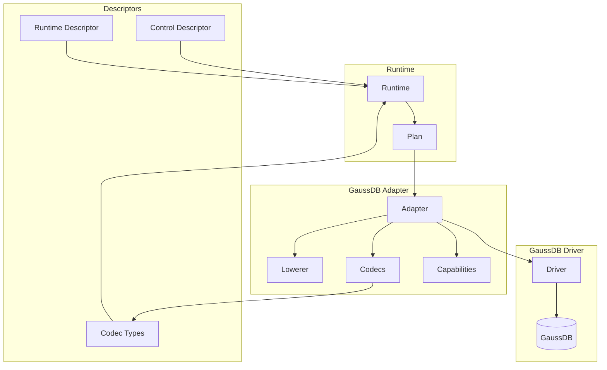

# @internal/adapter-gaussdb

GaussDB adapter for Prisma 8.

## Package Classification

- **Domain**: targets
- **Layer**: adapters
- **Plane**: multi-plane (shared, migration, runtime)

## Overview

The GaussDB adapter implements the adapter SPI for GaussDB databases. It provides SQL lowering, capability discovery, codec definitions, and error mapping for GaussDB-specific behavior. It also exports both control-plane and runtime-plane adapter descriptors for config wiring.

## Purpose

Provide GaussDB-specific adapter implementation, codecs, and capabilities. Enable GaussDB dialect support in Prisma 8 through the adapter SPI.

## Responsibilities

- **Adapter Implementation**: Implement `Adapter` SPI for GaussDB
  - Lower SQL ASTs to GaussDB dialect SQL
  - Render JSON aggregation (`json_agg`, `json_build_object`) and scalar subqueries
  - Advertise GaussDB capabilities (`orderBy`, `limit`, `returning`, `jsonAgg`)
  - Normalize GaussDB EXPLAIN output
  - Map GaussDB errors to `RuntimeError` envelope
- **Upsert Rendering**: Rewrite `InsertOnConflict` to GaussDB's `ON DUPLICATE KEY UPDATE` (see [GaussDB Dialect Notes](#gaussdb-dialect-notes))
- **Codec Definitions**: Define GaussDB codecs for type conversion
  - Wire format to JavaScript type decoding
  - JavaScript type to wire format encoding
- **Storage Type Control Hooks**: Provide control-plane hooks for contract-defined storage types (e.g., enums)
- **Codec Types**: Export TypeScript types for GaussDB codecs
- **Descriptors**: Provide adapter descriptors declaring capabilities and codec type imports

**Non-goals:**
- Transport/pooling management (drivers)
- Query compilation (sql-query)
- Runtime execution (runtime)

## Architecture

This package spans multiple planes:

- **Shared plane** (`src/core/**`): Core adapter implementation, codecs, and types that can be imported by both migration and runtime planes
- **Migration plane** (`src/exports/control.ts`): Control-plane entry point that exports the adapter descriptor for config files
- **Runtime plane** (`src/exports/runtime.ts`): Runtime-plane entry point that exports the runtime adapter descriptor



## Components

### Core (`src/core/`)

**Adapter (`adapter.ts`)**
- Main adapter implementation
- Lowers SQL ASTs to GaussDB SQL
- Renders joins (INNER, LEFT, RIGHT, FULL) with ON conditions
- Renders JSON aggregation (`json_agg`, `json_build_object`) and scalar subqueries
- Renders DML operations (INSERT, UPDATE, DELETE) with RETURNING clauses
- Rewrites upsert `onConflict` to `ON DUPLICATE KEY UPDATE` (GaussDB has no `ON CONFLICT`)
- Advertises GaussDB capabilities (`orderBy`, `limit`, `returning`, `jsonAgg`)
- Maps GaussDB errors to `RuntimeError`

**Codec Lookup (`codec-lookup.ts`)**
- Assembles the GaussDB codec registry from `@internal/target-gaussdb` built-ins plus contributed descriptors
- Stack-composed paths build the same combined registry from ordered descriptor contributions

**Types (`types.ts`)**
- GaussDB-specific types and utilities
- Re-exports SQL contract types

### Exports (`src/exports/`)

**Control Entry Point (`control.ts`)**
- Exports the control-plane adapter descriptor for CLI config
- Used by `prisma.config.ts` to declare the adapter

**Runtime Entry Point (`runtime.ts`)**
- Exports the runtime-plane adapter descriptor

**Adapter Export (`adapter.ts`)**
- Re-exports `createGaussDbAdapter` from core

**SQL Renderer Export (`sql-renderer.ts`)**
- Re-exports `renderLoweredSql` for direct lowering use

**Operation Types Export (`operation-types.ts`)**
- Re-exports the adapter's query operation type surface

**Types Export (`types.ts`)**
- Re-exports GaussDB-specific types

**Column Types Export (`column-types.ts`)**
- Exports column descriptors for built-in types (`textColumn`, `int4Column`, `boolColumn`, `byteaColumn`, `jsonColumn`, `jsonbColumn`, etc.)
- Parameterized helpers: `charColumn(length)`, `varcharColumn(length)`, `numericColumn(precision, scale?)`, `bitColumn(length)`, `varbitColumn(length)`, `timeTemporalColumn(precision?)`, `timeStringColumn(precision?)`, `timetzColumn(precision?)`, `intervalColumn(precision?)`
- Raw JSON helpers: `jsonColumn`, `jsonbColumn` — untyped raw JSON / JSONB column descriptors. For schema-typed JSON columns, use the per-library extension package (`@internal/extension-arktype-json` for arktype). The schema-accepting `json(schema)` / `jsonb(schema)` overloads previously shipped from the postgres adapter retired in Phase C of the codec-registry-unification project.

## GaussDB Dialect Notes

Verified against a live GaussDB 507 instance in Oracle-compatibility mode (`datcompatibility=A`); see the probe verification record for raw outputs.

**Upsert.** GaussDB has no `ON CONFLICT` clause. The renderer rewrites `InsertOnConflict` to `ON DUPLICATE KEY UPDATE`:

- `do-update-set` renders as `ON DUPLICATE KEY UPDATE "col" = <expr>`; `excluded."col"` references pass through unchanged (verified working on GaussDB).
- GaussDB rejects assignments to the conflict-target columns (the primary/unique key columns) inside `ON DUPLICATE KEY UPDATE`, so the renderer raises `RUNTIME.AST_INVALID` for such assignments rather than emitting SQL the server will refuse.
- `do-nothing` has no literal form (`ON DUPLICATE KEY UPDATE NOTHING` is invalid syntax). It is simulated by self-assigning the first insert column that is not a conflict target (`"col" = "col"`, the same approach Hibernate uses), which keeps the conflicting row's values untouched. When every insert column is a conflict target (e.g. a single-column table keyed by that column), no faithful rendering exists and the renderer raises `RUNTIME.AST_INVALID`.

**LATERAL.** GaussDB 507 does not support `LATERAL` joins, so both the target-level and SQL-family capabilities declare `lateral: false`.

**Enums.** Native enum storage types are supported (`sql.enums: true`), with one caveat carried from the probe: the default `search_path` (`"$user", public`) does not include business schemas, so enum type references in DDL must be schema-qualified. The renderer's enum cast path already quotes qualified names (`quoteQualifiedName`), and contract construction qualifies non-default-schema enum type names.

**Known limitations recorded for later tasks** (not asserted by this adapter): `gen_random_uuid()`/`uuid_generate_v4()` are absent, aggregate `FILTER` clauses and `LATERAL` are unsupported, temporary tables reject `serial` columns, and `avg()` returns a 16-decimal `numeric` formatting.

## Related Subsystems

- **[Adapters & Targets](../../../../docs/architecture%20docs/subsystems/5.%20Adapters%20&%20Targets.md)**: Detailed adapter specification
- **[Ecosystem Extensions & Packs](../../../../docs/architecture%20docs/subsystems/6.%20Ecosystem%20Extensions%20&%20Packs.md)**: Extension pack model

## Related ADRs

- [ADR 005 - Thin Core Fat Targets](../../../../docs/architecture%20docs/adrs/ADR%20005%20-%20Thin%20Core%20Fat%20Targets.md)
- [ADR 016 - Adapter SPI for Lowering](../../../../docs/architecture%20docs/adrs/ADR%20016%20-%20Adapter%20SPI%20for%20Lowering.md)
- [ADR 030 - Result decoding & codecs registry](../../../../docs/architecture%20docs/adrs/ADR%20030%20-%20Result%20decoding%20&%20codecs%20registry.md)
- [ADR 065 - Adapter capability schema & negotiation v1](../../../../docs/architecture%20docs/adrs/ADR%20065%20-%20Adapter%20capability%20schema%20&%20negotiation%20v1.md)
- [ADR 068 - Error mapping to RuntimeError](../../../../docs/architecture%20docs/adrs/ADR%20068%20-%20Error%20mapping%20to%20RuntimeError.md)
- [ADR 112 - Target Extension Packs](../../../../docs/architecture%20docs/adrs/ADR%20112%20-%20Target%20Extension%20Packs.md)
- [ADR 114 - Extension codecs & branded types](../../../../docs/architecture%20docs/adrs/ADR%20114%20-%20Extension%20codecs%20&%20branded%20types.md)
- [ADR 168 - GaussDB JSON and JSONB typed columns](../../../../docs/architecture%20docs/adrs/ADR%20168%20-%20GaussDb%20JSON%20and%20JSONB%20typed%20columns.md). Schema-typed JSON columns now ship from per-library extension packages (`@internal/extension-arktype-json` for arktype); see [ADR 208 - Higher-order codecs for parameterized types](../../../../docs/architecture%20docs/adrs/ADR%20208%20-%20Higher-order%20codecs%20for%20parameterized%20types.md).

## Usage

### Custom codec descriptors

`createGaussDbAdapter({ codecDescriptors })` accepts GaussDB-target descriptors and appends them to the built-ins before constructing one structurally validated registry. Stack-based runtime and control construction consume the same descriptors from `types.codecTypes.codecDescriptors`. See the [target-owned SQL codec descriptor guide](../../../../docs/reference/codec-authoring-guide.md#target-owned-sql-codec-descriptors); do not inject separate generic and GaussDB lookups.

### Runtime

```typescript
import { createGaussDbAdapter } from '@internal/adapter-gaussdb/adapter';
import { createRuntime } from '@internal/sql-runtime';

const runtime = createRuntime({
  contract,
  adapter: createGaussDbAdapter(),
  driver: gaussdbDriver,
});
```

### CLI Config

```typescript
import gaussdbAdapter from '@internal/adapter-gaussdb/control';

export default defineConfig({
  family: sql,
  target: gaussdb,
  adapter: gaussdbAdapter,
  extensions: [],
});
```

## Capabilities

The adapter declares the following capabilities (identical in `src/core/adapter.ts` `defaultCapabilities` and `src/core/descriptor-meta.ts` `gaussdbAdapterDescriptorMeta.capabilities`):

- **`gaussdb.orderBy: true`** - Supports ORDER BY clauses
- **`gaussdb.limit: true`** - Supports LIMIT clauses
- **`gaussdb.returning: true`** - Supports RETURNING clauses for DML operations (INSERT, UPDATE, DELETE)
- **`gaussdb.jsonAgg: true`** - Supports JSON aggregation functions (`json_agg`)
- **`sql.enums: true`** - Supports contract-defined enum storage types
- **`sql.returning: true`** - SQL-family RETURNING support
- **`sql.defaultInInsert: true`** - Supports DEFAULT in INSERT value positions
- **`sql.lateral: false`** - LATERAL joins are NOT supported on GaussDB 507
- **`sql.scalarList: true`** - Supports scalar list literals (`'{1,2}'::int[]`)
- **`sql.checkConstraint: true`** - Supports CHECK constraints
- **`sql.distinctOn: true`** - Supports DISTINCT ON

**Important**: Capabilities must be declared in **both** places:

1. **Adapter descriptor** (`src/core/descriptor-meta.ts`, surfaced through `src/exports/control.ts` and `src/exports/runtime.ts`): Capabilities are read during emission and included in the contract
2. **Runtime adapter code** (`src/core/adapter.ts`): The `defaultCapabilities` constant is used at runtime via `adapter.profile.capabilities`

The capabilities on the descriptor must match the capabilities in code. If they don't match, emitted contracts and runtime capability checks will diverge.

See `docs/reference/capabilities.md` and `docs/architecture docs/subsystems/5. Adapters & Targets.md` for details.

## JSON Aggregation

The renderer lowers JSON-aggregation AST nodes to GaussDB's `json_agg`:

- `json_agg(json_build_object(...))` aggregates a row set into a JSON array of objects
- A scalar subquery (`SubqueryExpr`) in the SELECT list correlates against the outer row through its WHERE clause
- When the subquery carries an inner `ORDER BY` and `LIMIT`, its rows are wrapped in an inner SELECT, then aggregated with `json_agg(row_to_json(sub.*))`

**Example SQL Output:**
```sql
SELECT "user"."id" AS "id", (
  SELECT json_agg(json_build_object('id', "post"."id", 'title', "post"."title")) AS "posts"
  FROM "post"
  WHERE "user"."id" = "post"."userId"
) AS "posts"
FROM "user"
```

## DML Operations with RETURNING

The adapter supports RETURNING clauses for DML operations (INSERT, UPDATE, DELETE), allowing you to return affected rows:

**Lowering Strategy:**
- Renders `RETURNING` clause after INSERT, UPDATE, or DELETE statements
- Returns specified columns from affected rows
- Supports returning multiple columns

**Capability Required:**
- `returning: true` - Enables RETURNING clause support

**Example SQL Output:**
```sql
-- INSERT with RETURNING
INSERT INTO "user" ("email", "createdAt") VALUES ($1, $2) RETURNING "user"."id", "user"."email"

-- UPDATE with RETURNING
UPDATE "user" SET "email" = $1 WHERE "user"."id" = $2 RETURNING "user"."id", "user"."email"

-- DELETE with RETURNING
DELETE FROM "user" WHERE "user"."id" = $1 RETURNING "user"."id", "user"."email"
```

## JSON and JSONB support

The adapter supports GaussDB-native `json` and `jsonb` columns.

### Value semantics

Both `json` and `jsonb` accept any valid JSON value:

- object
- array
- string
- number
- boolean
- JSON `null` (distinct from SQL `NULL`)

`jsonb` uses normalized binary storage, so whitespace and object key order are not preserved.

### Authoring helpers

```typescript
import { jsonbColumn } from '@internal/adapter-gaussdb/column-types';
import { arktypeJson } from '@internal/extension-arktype-json/column-types';
import { type as arktype } from 'arktype';

const auditPayloadSchema = arktype({
  action: 'string',
  actorId: 'number',
});

table('event', (t) =>
  t
    // Schema-typed JSONB via the per-library extension package.
    .column('payload', { type: arktypeJson(auditPayloadSchema), nullable: false })
    // Untyped raw JSONB via the adapter's static descriptor.
    .column('raw', { type: jsonbColumn, nullable: true }),
);
```

### Typed fallback behavior

- For schema-typed columns, use a per-library extension package (e.g., `@internal/extension-arktype-json`). The emit-path renderer reads the schema's `expression` from typeParams and produces a concrete TS type in `contract.d.ts`.
- For untyped columns (`jsonColumn`, `jsonbColumn`), the emitted type falls back to `JsonValue`.
- Runtime values still encode/decode as JSON-compatible values.

## Exports

- `./adapter`: Adapter implementation (`createGaussDbAdapter`)
- `./column-types`: Column type descriptors and authoring helpers (`jsonColumn`, `jsonbColumn`, `textColumn`, `int4Column`, etc.)
- `./types`: GaussDB-specific types
- `./control`: Control-plane entry point (adapter descriptor)
- `./runtime`: Runtime-plane entry point (runtime adapter descriptor)
- `./sql-renderer`: `renderLoweredSql` export
- `./operation-types`: Query operation type surface

## Tests

The unit suite covers the adapter, renderer, control adapter, marker/ledger write lowering, DDL lowering, descriptor metadata, and codec composition — all without an external database.

- **Default (`pnpm --filter @internal/adapter-gaussdb test`)**: runs the unit suite plus the dialect-independent top-level integration tests (scalar-list, temporal, array-lift, and mixed-case-enum-cast round-trips), which run against the PGlite host engine
- **Representative test files**:
  - `test/dialect-upsert.test.ts`: GaussDB `ON DUPLICATE KEY UPDATE` rendering and its error branches
  - `test/adapter.test.ts`: select/insert/update/delete lowering, param casts, JSON projections
  - `test/marker-ledger-writes.test.ts`: control-plane marker/ledger write SQL shapes
  - `test/sql-renderer.cast-policy.test.ts`: `$N` vs `$N::<type>` cast policy
  - `test/migrations/planner.fk-config.test.ts`: migration planner behaviour

Migration-plane integration tests under `test/migrations/` exercise dialect-specific DDL and the marker/ledger upsert path, which this adapter renders as `ON DUPLICATE KEY UPDATE` — syntax the PGlite host engine rejects. That dialect-specific integration coverage is gated to Task 8 live-GaussDB journeys.
