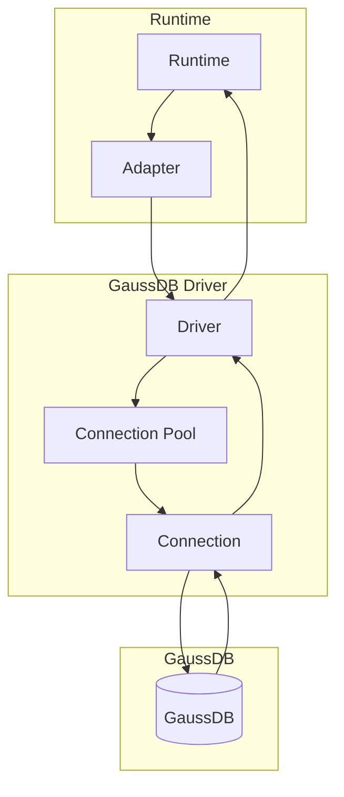

# @internal/driver-gaussdb

GaussDB driver for Prisma 8.

## Package Classification

- **Domain**: targets
- **Layer**: drivers
- **Plane**: multi-plane (migration, runtime)

## Overview

The GaussDB driver provides transport and connection management for GaussDB databases. GaussDB speaks the PostgreSQL wire protocol, so this driver is built directly on the node `pg` stack (`pg` + `pg-cursor`) with no GaussDB-specific transport code. It implements the `SqlDriver` interface for executing SQL statements, explaining queries, and managing connections.

In Prisma 8, "driver" refers to the Prisma 8 interface (not the underlying `pg` library). Drivers are transport-agnostic: they own pooling, connection management, and transport protocol (TCP, HTTP, etc.), but contain no dialect-specific logic. All dialect behavior lives in adapters. Instantiation is separate from connection; `create()` returns an unbound driver, `connect(binding)` binds at the boundary ([ADR 159](../../../../docs/architecture%20docs/adrs/ADR%20159%20-%20Driver%20Terminology%20and%20Lifecycle.md)).

This package spans multiple planes:

- **Migration plane** (`src/exports/control.ts`): Control plane entry point for driver descriptors
- **Runtime plane** (`src/exports/runtime.ts`): Runtime entry point for driver implementation

## Purpose

Provide GaussDB transport and connection management. Execute SQL statements and manage connections without dialect-specific logic.

## Responsibilities

- **Connection Management**: Acquire and release database connections
- **Statement Execution**: Execute SQL statements with parameters
- **Query Explanation**: Execute EXPLAIN queries for query analysis
- **Connection Pooling**: Manage connection pools (when applicable)
- **Transport Protocol**: Handle the PostgreSQL wire protocol shared with GaussDB

**Non-goals:**

- Dialect-specific SQL lowering (adapters)
- Query compilation (sql-query)
- Runtime execution (runtime)

## Architecture



## Components

### Driver (`gaussdb-driver.ts`)

- Main driver implementation
- Implements `SqlDriver` interface
- Manages connections and executes statements
- Handles the PostgreSQL wire protocol

## Related Subsystems

- **[Adapters & Targets](../../docs/architecture%20docs/subsystems/5.%20Adapters%20&%20Targets.md)**: Driver specification

## Related ADRs

- [ADR 159 — Driver Terminology and Lifecycle](../../../../docs/architecture%20docs/adrs/ADR%20159%20-%20Driver%20Terminology%20and%20Lifecycle.md)
- [ADR 005 — Thin Core Fat Targets](../../../../docs/architecture%20docs/adrs/ADR%20005%20-%20Thin%20Core%20Fat%20Targets.md)
- [ADR 016 — Adapter SPI for Lowering](../../../../docs/architecture%20docs/adrs/ADR%20016%20-%20Adapter%20SPI%20for%20Lowering.md)

## Usage

Use the descriptor + connect lifecycle:

```typescript
import gaussDbRuntimeDriverDescriptor from '@internal/driver-gaussdb/runtime';

const driver = gaussDbRuntimeDriverDescriptor.create({ cursor: { batchSize: 100 } });
await driver.connect({ kind: 'url', url: process.env.DATABASE_URL });
// driver is now bound; use acquireConnection, query, execute, etc.
```

Binding variants:

- `{ kind: 'url', url }`: Driver creates a pg Pool from the connection string
- `{ kind: 'pgPool', pool }`: Use an existing pg Pool
- `{ kind: 'pgClient', client }`: Use an existing pg Client (direct connection)

With `cursor: { disabled: true }` (or buffered cursor fallback), driver-level pool queries return their connection after fetching, before yielding buffered rows for decoding or consumption. Cursor streams retain the connection until completion or iterator cleanup. Queries on caller-owned connections and transactions never release the caller's lease.

## Exports

- `./runtime`: Runtime entry point for driver implementation
  - Default: `gaussDbRuntimeDriverDescriptor` — use `create()` for unbound driver, then `connect(binding)`
  - Types: `GaussDbBinding`, `GaussDbDriverCreateOptions`, `QueryResult`
- `./control`: Control plane entry point for driver descriptors
  - Default export: `DriverDescriptor` for use in `prisma.config.ts`

## Tests

The suite exercises the driver mechanism (pooling, serialization, cursors, prepared statements, error normalization) against `pg-mem` and PGlite — no GaussDB instance required, since the driver is dialect-free over the shared wire protocol.

- **Default (`pnpm --filter @internal/driver-gaussdb test`)**: runs the unit suite plus the PGlite-backed integration tests
- **Representative test files**:
  - `test/driver.basic.test.ts`: connect/binding lifecycle, query, execute, explain
  - `test/driver.errors.test.ts`: error normalization propagation and buffered-mode fallback
  - `test/driver.prepared.test.ts`: prepared-statement handle reuse and stale-handle retry
  - `test/driver.stream-portal-protection.integration.test.ts`: BEGIN/COMMIT wrap around cursor streams
  - `test/named-cursor.wire.integration.test.ts`: named-portal cursor over a real server
  - `test/normalize-error.test.ts`: SQLSTATE and connection-error normalization
